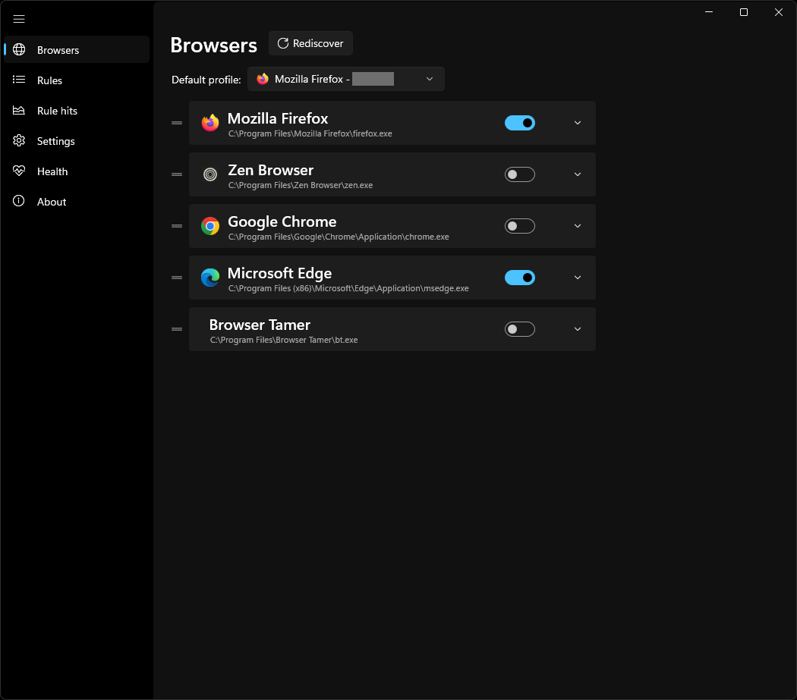
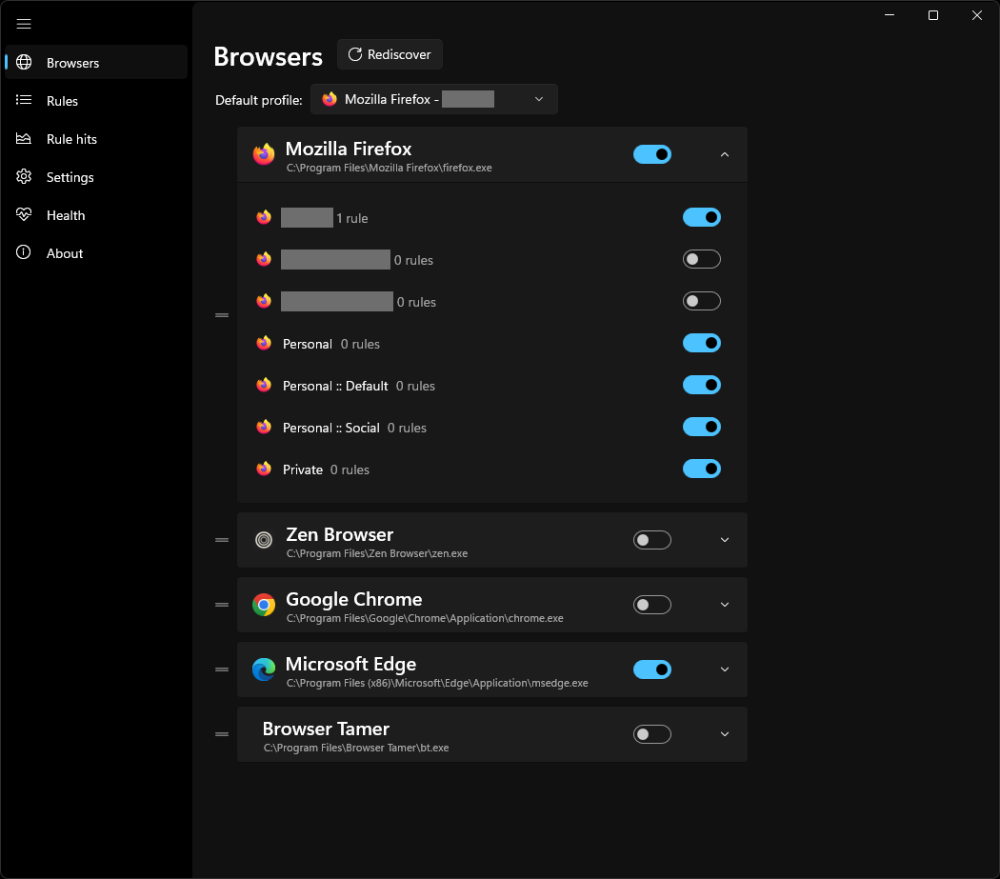
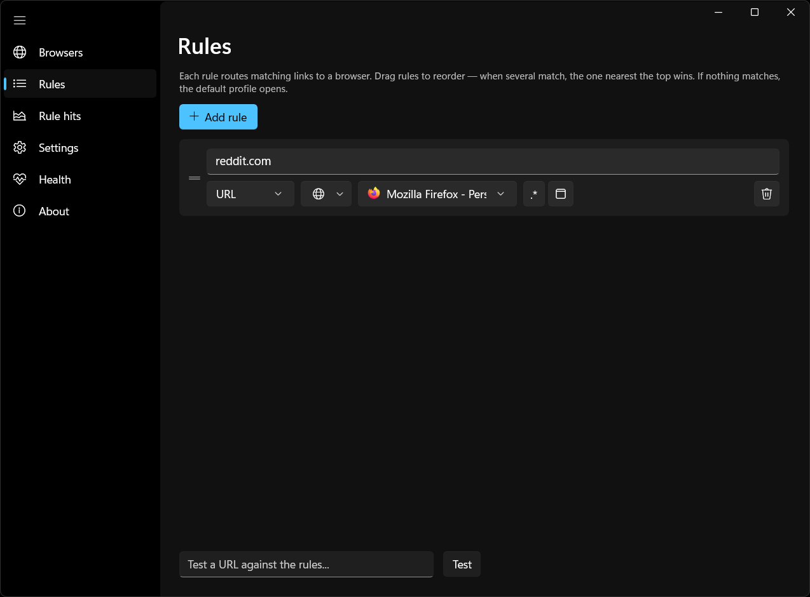
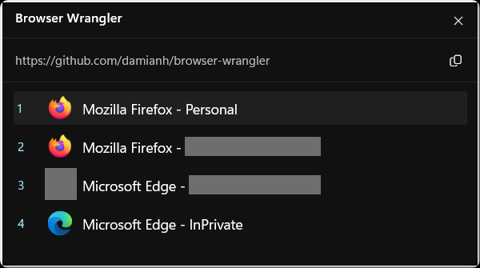

# Browser Wrangler

[](https://github.com/damianh/browser-wrangler/actions/workflows/ci.yml)
[](https://github.com/damianh/browser-wrangler/actions/workflows/release.yml)
[](https://github.com/damianh/browser-wrangler/releases/latest)
[](LICENSE)

Browser Wrangler registers itself as a browser on Windows and Linux, intercepts
the links you click, and routes them to the right browser and profile based on
rules you define — with an optional picker popup and toast notifications.

Project website (GitHub Pages): https://damianh.github.io/browser-wrangler/

It is a .NET 10 fork of [Browser Tamer](https://github.com/aloneguid/bt)
by [aloneguid](https://github.com/aloneguid), licensed under the Apache License 2.0,
with a WinUI 3 app on Windows and an Avalonia app on Linux.

## Installation

### Windows

Grab the installer / portable zip from the
[latest release](https://github.com/damianh/browser-wrangler/releases/latest)
(x64 and ARM64). Installs per-user — no admin required.

For the **dev channel**, install from the latest
[prerelease](https://github.com/damianh/browser-wrangler/releases?q=prerelease%3Atrue)
artifact named `BrowserWrangler-dev-...`. It installs side-by-side as
**Browser Wrangler (Dev Channel)**.

The installer registers Browser Wrangler as a browser and opens a short setup
window afterwards. Windows only lets *you* pick the default browser, so that
window has a button straight to the right page in **Windows Settings** and ticks
itself off as soon as Windows reports the change. If you close it too early, the
app shows the same steps the next time you open it, and the **Health** page has
them permanently.

### Linux

Each release has x64 and ARM64 builds for Linux. Everything installs per user, with no root needed.

- **Tarball**: extract `BrowserWrangler-<version>-linux-<arch>.tar.gz` and run
  `./install.sh`. It copies the app to `~/.local/opt/browser-wrangler`, links
  `~/.local/bin/browser-wrangler` and registers the app as a browser.
  `install.sh --uninstall` removes it again.
- **AppImage**: download `BrowserWrangler-<version>-linux-<arch>.AppImage`,
  make it executable and run it. The welcome window registers that AppImage, so
  keep the file where it is, or open it once more after moving it.
- **Nix**: the repository is a flake. Run it with
  `nix run github:damianh/browser-wrangler`, or add
  `inputs.browser-wrangler.packages.${system}.default` (or
  `overlays.default`) to your configuration. The package ships the `.desktop`
  file and icon.

The first time you open the app, a welcome window offers to register it and make it the default browser. Making it the default writes `~/.config/mimeapps.list`, and on KDE also sets the default browser in KDE's settings.
You can do the same from the command line with `browser-wrangler --register` and
`browser-wrangler --make-default`. The **Health** page shows the current state.

What's different on Linux:

- Browsers and profiles are found from `.desktop` files, the same way your
  desktop finds them. Settings are stored under `~/.config/browser-wrangler`.
- **Picker hotkeys**: Caps Lock works everywhere. Ctrl/Alt/Shift combinations
  only work in an X11 session, because Wayland doesn't let one app read keys that
  were pressed in another. In a Wayland session the Settings page hides those
  options.
- On Wayland, your compositor decides where the picker appears and whether it
  gets keyboard focus.
- Updates only notify you. Install the new build with the same method you used
  the first time.
- SVG-only browser icons are shown as a letter instead.

## Features

- **Registers as a browser** — per-user registry (no admin), guided first-run setup, health checks with one-click fixes
- **Browser & profile discovery** — installed browsers, Chromium profiles, Firefox profiles, Firefox Multi-Account Containers, incognito/private entries, with real profile avatars
- **Rules engine** — substring/regex match on whole URL, domain or path; drag-to-reorder priority; fallback default profile; bt-compatible rule syntax (`scope:domain|priority:2|github.com`)
- **URL pipeline** — Outlook Safelinks unwrap, optional shortened-link expansion, and find/replace substitutions (`substr|find|replace`, `rgx|find|replace`)
- **Picker** — popup listing browsers/profiles with number-key shortcuts; triggered by hotkeys (Ctrl+Shift etc.), rule conflicts, or no-match
- **Toast** — brief notification showing which rule routed to which browser
- **Fast cold-start** — URL invocations route and launch without initializing XAML unless UI is needed; Native AOT-compiled releases
- **No background process** — runs on demand per click, exits when done

## Screenshots

### Browsers

Toggle which browsers appear in the picker, and drag to reorder them.



Expand a browser to toggle its profiles, containers and private/incognito entries.



### Rules

Drag to reorder — topmost matching rule wins. Test any URL against your rules.



### Picker

Pops up when a URL matches multiple rules, no rules, or when you hold a hotkey.
Pick with the mouse, the number keys (`1`–`9`, `0` for the tenth entry), or the arrow keys plus `Enter`. `Esc` cancels.



## Firefox containers

Browser Wrangler can route links to Firefox Multi-Account Containers as profile targets.

This requires the Firefox extension
[Open external links in a container](https://addons.mozilla.org/firefox/addon/open-url-in-container/)
to be installed in Firefox.

## Building

### Windows

Requires .NET SDK 10 on Windows.

```pwsh
dotnet build src\BrowserWrangler -p:Platform=x64
dotnet test tests\BrowserWrangler.Core.Tests
```

Run `BrowserWrangler.exe` with no arguments for the config UI; it re-registers
itself if the exe has moved, and shows the first-run setup window until Browser
Wrangler is the default browser. `--first-run` forces that window, `--register`
and `--unregister` are the silent installer hooks.

### Linux

Requires .NET SDK 10. Native AOT publishing also needs `clang` and `zlib`
development headers (`clang zlib1g-dev` on Debian/Ubuntu).

```sh
dotnet run --project src/BrowserWrangler.Linux
dotnet test tests/BrowserWrangler.Core.Tests
installer/linux/build.sh --appimage   # tarball + AppImage in ./artifacts
nix build                             # Nix package
```

When you change NuGet packages, regenerate the Nix lock file with
`nix build .#default.fetch-deps && ./result nix/deps.json`.

## Layout

- `src/BrowserWrangler.Core` — models, discovery, rules, pipeline, launching and the
  platform layer (`Platform/Windows`: registry; `Platform/Linux`: XDG, `.desktop`,
  `mimeapps.list`); no UI deps
- `src/BrowserWrangler` — WinUI 3 app (Windows): config UI, picker, toast
- `src/BrowserWrangler.Linux` — Avalonia app (Linux): config UI, picker, toast
- `tests/BrowserWrangler.Core.Tests` — xUnit tests
- `installer/` — Inno Setup script and release manifest templates (Windows);
  `installer/linux/` — tarball/AppImage build script and installer
- `flake.nix`, `nix/` — Nix package

## Reporting a problem

Open the **About** page in the app and click **Report an issue**. That opens a bug
report with the app info (version, runtime, Windows build, config and log paths)
already filled in — please add a screenshot if you can. **Copy diagnostics** puts
the same block on the clipboard if you would rather paste it somewhere else.

The About page has a **Check for updates** button that compares your build
against the latest release for your channel. Automatic update checks are enabled
by default when the config app is open (you can turn them off in **Settings**),
and optional installer auto-download still requires manual install confirmation.

## License

Apache License 2.0 — see [LICENSE](LICENSE). Portions derived from
[Browser Tamer](https://github.com/aloneguid/bt), Copyright aloneguid,
Apache License 2.0 — see [NOTICE](NOTICE).
